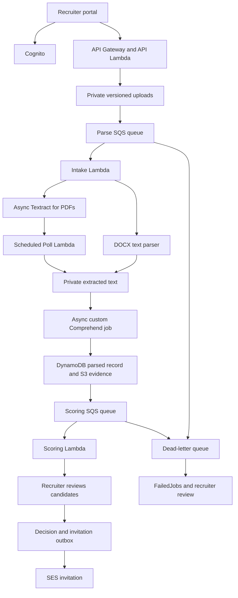

# TalentFlow — AI Resume Screener & Recruitment Pipeline

A standalone AWS recruitment demonstration with a private resume pipeline, actual Amazon Comprehend custom entity inference, transparent candidate/job matching, a recruiter dashboard, and reviewed interview invitations.

**This is separate from DayOne and LeaveFlow.** Use stack `talentflow`. It creates a separate Cognito pool, private buckets, tables, queues, and functions.

## What is built

- Recruiter login through Cognito and authenticated API Gateway business routes.
- Job creation, private PDF/DOCX uploads, and batches of up to 20 resumes per browser selection.
- PDF text extraction through asynchronous Amazon Textract; DOCX text extraction through a bounded Python XML/ZIP parser.
- Built-in Comprehend extraction for people, organization mentions, and dates.
- A trained custom Comprehend recognizer for `SKILL` and `JOB_TITLE`, invoked through asynchronous entity-detection jobs.
- Recruiter-confirmed JD requirements: extracted optional skills are not silently treated as mandatory.
- Explainable 50/30/20 scoring, extracted evidence, review-required cases, and reviewed corrections.
- Explicit recruiter shortlist/reject decisions. Shortlisting writes an email outbox record atomically with the decision and its audit event.
- SES interview invitations, invitation-status visibility, and shortlist CSV export.
- Parse and scoring SQS queues, a dead-letter queue, a failure-record consumer, and DynamoDB failed-job records.
- CloudWatch logs, operational alarms, and SNS alert subscription.
- SAM infrastructure, training/setup scripts, 3 fictional resumes, sample JD, tests, and deliverable guides.

**What is not claimed:** no model has been trained in your AWS account by this archive; no live Textract/Comprehend result or deployment screenshot is fabricated. See `docs/validation.md` for checks performed locally and remaining live checks.

## Important ML distinctions

Textract cannot directly read DOCX. The DOCX branch uses an XML parser; PDF uses Textract. Built-in Comprehend `TITLE` means a creative-work title, not a job title. Therefore our job titles and skills use a custom entity recognizer. The final score is a documented rule over extracted entities, not a separate trained hiring-success predictor.

The included 300 training documents and 100 test documents are **synthetic bootstrap data**, not a production recruitment dataset. Their evaluation metrics do not establish performance on real resumes. The three demo resumes are separate from training. Train and evaluate a stronger consented dataset before considering real use.

All ranking is decision support. Missing extraction is flagged, not treated as evidence that a candidate has no ability. A recruiter must review source information and save a review before any final decision. No protected characteristics, names, email domains, institution prestige, cover-letter sentiment, or employer prestige contribute to the score.

## Architecture



A one-minute EventBridge rule runs the dispatcher/poller. Lambda does **not** sit waiting for OCR or Comprehend. A maximum of two custom jobs is started per polling invocation; service throttling is retried in later polls. This modest-workload demo uses one inference job per document. Batch inference avoids maintaining a paid custom-model real-time endpoint, but results are not instantaneous. No Step Functions state machine is required for this project's specification; durable document states, queues, and polling coordinate the stages.

## 1. Open the extracted folder in VS Code

Extract `talentflow-system.zip`, then open the inner `talentflow` directory, which contains this README and `template.json`.

Open **Terminal → New Terminal → PowerShell**. Run one command at a time. Stop if a command fails.

```powershell
python --version
aws --version
sam --version
aws sts get-caller-identity --profile my-account
```

The template uses Python 3.14 to match your previous environment. If Windows redirects `python` to the Microsoft Store, use the installed Python directory that worked previously:

```powershell
$pythonDir = "$env:LOCALAPPDATA\Python\pythoncore-3.14-64"
$env:Path = "$pythonDir;$pythonDir\Scripts;$env:Path"
python --version
```

Confirm the intended AWS account and a non-root authorized deployer. Do not paste credentials in chat or commit them. Previously exposed credentials must be revoked/replaced.

## 2. Install dependencies and validate

```powershell
python -m pip install -r requirements-dev.txt
python -m pytest tests -q
python scripts/build_template.py
sam validate --lint --template-file template.json --profile my-account --region us-east-1
sam build --template-file template.json
```

Development dependencies support tests/sample generation; the Lambda handlers use Python's standard library and runtime-provided boto3. There is no frontend npm build.

## 3. Prepare permissions and email

An account administrator must authorize deployment of this separate stack. A DayOne-only policy will not automatically allow TalentFlow resources.

```powershell
python scripts/deployment_policy.py --profile my-account --region us-east-1 --stack talentflow
```

This writes `deployment-policy.json`; it does **not** attach permissions. Have an administrator review it and create/attach a **customer-managed policy**. It is a deployment-policy starting point with broad permissions for some create/list APIs, not a claim of perfect least privilege. Additional account-level restrictions can still block deployment. Runtime Lambda permissions are defined separately in the SAM template.

In SES, Region `us-east-1`, verify the sender. If sandboxed, verify the recruiter and candidate demonstration recipient addresses as required. Copy the sender identity ARN. Use controlled test inboxes; example.test addresses in sample resumes cannot receive mail.

## 4. Deploy the application

```powershell
sam deploy --guided --profile my-account --region us-east-1
```

| Prompt | Value |
|---|---|
| Stack name | `talentflow` (lowercase) |
| AWS Region | `us-east-1` |
| SenderEmail | Your verified SES sender |
| RecruiterEmail | Your recruiter/operational-alert test inbox |
| SESIdentityArn | Verified sender identity ARN in the same Region |
| Confirm changes | Y |
| Allow IAM role creation | Y after reviewing the template |
| Disable rollback | N |
| Save configuration | Y; defaults for filename/environment |

Review and approve the change set. Deployment creates billable AWS resources. It does **not** train the recognizer automatically. Confirm the SNS operational-alert subscription email after creation.

```powershell
aws cloudformation describe-stacks --stack-name talentflow --profile my-account --region us-east-1 --query "Stacks[0].Outputs" --output table --no-cli-pager
```

## 5. Configure and publish the frontend

```powershell
python scripts/setup.py --profile my-account --region us-east-1 --stack talentflow configure
$webBucket = Read-Host "Paste WebBucket from stack outputs"
aws s3 sync .\frontend "s3://$webBucket" --profile my-account --region us-east-1 --cache-control "max-age=60"
```

No public bucket access or public-read ACL is needed. CloudFront uses Origin Access Control. Open `PortalUrl` from stack outputs. If updated files are cached, wait for expiry or invalidate the relevant CloudFront paths deliberately.

## 6. Create your recruiter

```powershell
$recruiterEmail = (Read-Host "Recruiter email").Trim()
python scripts/setup.py --profile my-account --region us-east-1 --stack talentflow recruiter --email $recruiterEmail
```

Use the email invitation to log in. Complete the new-password challenge. All authorized recruiters in this demonstration share one recruitment workspace; this is not a multi-tenant SaaS design.

## 7. Train the custom recognizer

The archive already includes generated synthetic training files. Regenerate only if needed:

```powershell
python scripts/make_training.py
```

Review the dataset, current regional pricing, and `docs/model-training.md` before starting. Training and batch inference incur AWS charges. This design creates no persistent inference endpoint.

```powershell
python scripts/train.py --profile my-account --region us-east-1 --stack talentflow start
```

Copy the returned recognizer ARN. Training is asynchronous and can take a substantial amount of time. Check progress rather than starting multiple training jobs:

```powershell
$modelArn = Read-Host "Paste the recognizer ARN"
python scripts/train.py --profile my-account --region us-east-1 --stack talentflow status --model-arn $modelArn
```

When status is `TRAINED`, inspect the evaluation metrics. Activate the model for the fictional-data demonstration:

```powershell
python scripts/train.py --profile my-account --region us-east-1 --stack talentflow activate --model-arn $modelArn --accept-demo-model
```

This stores the model ARN in Config and writes evaluation metadata to `docs/model-evaluation.json`. It does not make the model appropriate for real hiring. If training fails, inspect the returned status/message in Comprehend before retrying. There is no hidden keyword-extraction fallback.

## 8. Run the complete journey

1. Sign in, refresh the page, and confirm a custom model is connected.
2. Create the role `Cloud Engineer`.
3. Upload `samples/job-descriptions/cloud-engineer.docx`.
4. Watch Document processing. Wait for `JD_REVIEW`; async processing can take minutes.
5. Review required skills, acceptable titles, minimum experience, and threshold against the actual JD. Confirm/freeze requirements. Create another job for changed requirements.
6. Upload all three files in `samples/resumes`. The browser allows 20 files per selection; this starter targets small batches, not production-scale intake.
7. Refresh/poll until candidate records appear. PDF goes through Textract; DOCX uses its text branch. Files have a 10 MB app limit and PDFs a post-extraction 30-page limit; oversized PDFs can incur OCR charges before that check.
8. Open a candidate. Read Source and ML evidence. Confirm name, contact email, skills, titles, verified employers, and experience. Enter an evidence/review note, then Save reviewed information.
9. Replace the synthetic contact address with a verified test inbox you control. Enter a decision reason, interview date/time **with timezone**, format/link or location, and scheduling instructions.
10. Check the invitation confirmation box and shortlist. The scheduled Mailer should send the outbox email. Observe its status and verify actual mailbox receipt.
11. Review another candidate and explicitly reject if appropriate for the test. No email is sent for rejection in this version.
12. Download the shortlist CSV and collect deliverable evidence as described below.

If an upload was interrupted, use **Resume upload** in the document row. For processing failures, inspect Failed jobs and CloudWatch, fix the cause, then use Retry. Never change DynamoDB status manually to force an apparent success.

## Deliverables

| Requested deliverable | Included support / what you capture live |
|---|---|
| End-to-end pipeline demo | `docs/demo-guide.md`, sample files, working handlers and UI; record your live journey |
| Extraction output for 3 resume types | Actual evidence stored per processed file; export with `scripts/capture_evidence.py` |
| Dashboard with matches and skills | `frontend/` with review-required handling and score details |
| Matching explanation + 3 improvements | `docs/matching-logic.md` |
| Reliability and edge cases | `docs/edge-cases.md`, tests, DLQ and failure storage |
| Schema | `docs/schema.md` |

```powershell
python scripts/capture_evidence.py --profile my-account --region us-east-1 --stack talentflow --document-ids DOCUMENT_ID_1 DOCUMENT_ID_2 DOCUMENT_ID_3
```

Replace the placeholders with document IDs from your records. This downloads **real** extraction JSON after processing. No made-up Comprehend response is supplied as a deliverable.

## Updating and cleaning up

For backend/template changes: edit source, regenerate the template, test, `sam build`, then `sam deploy --profile my-account --region us-east-1`. For frontend changes: upload changed frontend files separately.

Stop unnecessary demo activity. `sam delete --stack-name talentflow --profile my-account --region us-east-1` prompts for stack deletion. Tables, buckets, and the user pool intentionally have retention policies; they remain and may still cost money. Inspect and remove retained data manually only when no longer needed. Training models are created outside CloudFormation; manage/delete them separately in Comprehend after jobs finish. Never empty DayOne or LeaveFlow buckets while cleaning this separate project.

## Boundaries

English-only text pipeline; no malware scanning; no third-party calendar booking; no automatic requirement changes/rescoring after confirmation; no multi-tenant isolation; no candidate deletion UI or employment-law compliance engine. DOCX images/headers are not OCR'd by its text-only parser. Experience extraction is a conservative heuristic and requires human verification. Organization mentions are not automatically asserted to be employers. Identity extraction can be uncertain. Long/resumed job processing and retries can incur additional charges.

SES delivery is at-least-once: a crash after sending but before recording SENT can duplicate an invitation. Failed sends remain PENDING with an error and are retried; they do not roll back the shortlist. See the reliability documentation before real use.
