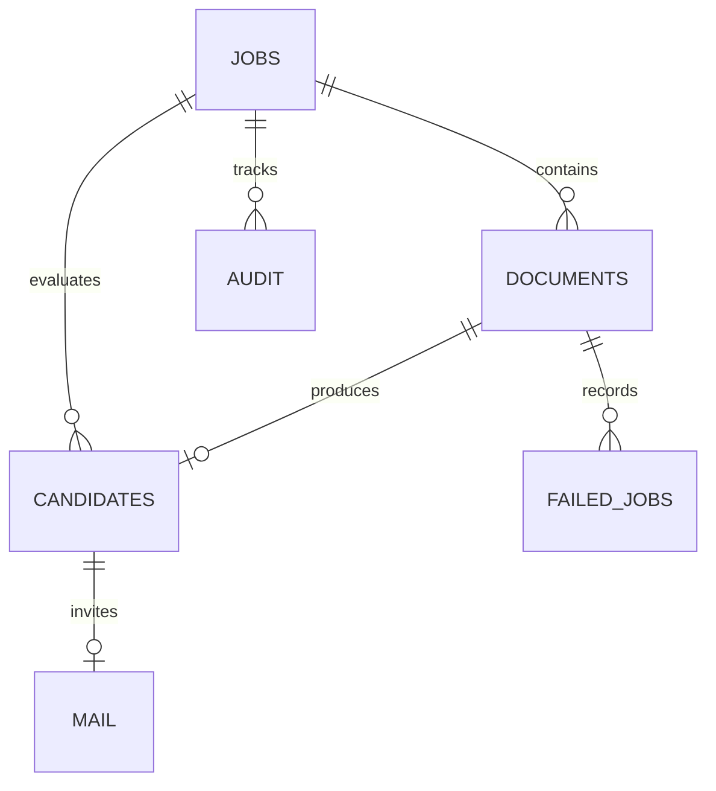

# DynamoDB schema

All tables use on-demand capacity, encryption, point-in-time recovery, and retention on stack deletion.

| Table | PK | SK | Indexes / contents |
|---|---|---|---|
| Jobs | job_id | — | ByKind(kind); title, status, extracted JD, confirmed requirements, version, reviewer |
| Documents | doc_id | — | ByJob(job_id), ByState(state); private source key/version, kind, processing IDs, parsed record, error |
| Candidates | doc_id | — | ByJob(job_id); original extraction, reviewed fields, score explanation, revision, decision |
| FailedJobs | failure_id | — | ByJob(job_id); doc_id, stage, error, attempt identity, timestamp |
| Config | config_id | — | model recognizer ARN and explicit demonstration metadata |
| Audit | job_id | event_id | actor, action, details; chronological timestamp+UUID key |
| Mail | mail_id | — | ByState(state), ByJob(job_id); durable invitation intent, recipient/body, delivery state/error |

A candidate record is job-specific (doc_id); the demo does not deduplicate a person across jobs. An S3 event is associated with a pre-created document record; the first accepted version is pinned. Reusing an upload form cannot silently replace the version being processed.

Private S3 prefixes: `uploads/jds/`, `uploads/resumes/`, `text/`, `evidence/`, `nlp-output/`, `training/`. Only `uploads/` produces S3 intake events, preventing output-trigger loops. Large text/raw inference JSON stay in S3; compact structured data stay in DynamoDB.

All recruiters share one workspace. ByJob and ByState are eventually consistent GSIs; the UI can briefly lag. Reads of individual records use consistent reads. Critical decisions use conditional transactions against authoritative records. Index queries are paginated, but dashboard responses and scheduling target modest demo workloads; introduce per-tenant partitioning, API cursors, bounded queues and stricter scheduling fairness for scale.
